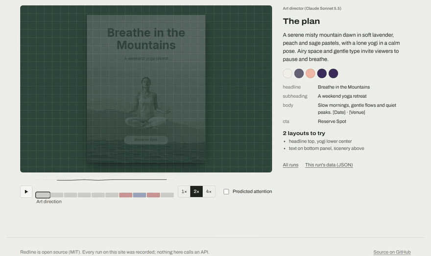

# Redline

**ESLint for designs, plus an AI that fixes what it finds.** Redline scores a poster, social post or ad from 0 to 100, ties every problem to specific elements with a machine-readable fix, and can hand the design to Claude to repair it, or generate one from a prompt.

[](https://www.npmjs.com/package/@simonlunay/redline)
[](https://github.com/simonlunay/redline/actions/workflows/pages.yml)
[](LICENSE)



**Live site: [simonlunay.github.io/redline](https://simonlunay.github.io/redline/)**. Replays recorded runs step by step and runs the checker in your browser while you edit a design. Static: no server, no keys, no AI calls. ([MP4 of the demo](docs/media/redline-demo.mp4))

## Why

AI tools are good at producing designs and bad at noticing their own mistakes: white text on a pale photo, a headline sliding under the product shot, a stretched logo, a button label that doesn't fit. Redline is the missing feedback signal. It checks a design against concrete, explainable rules and describes each problem precisely enough for a program to repair it.

## What it does

- **Check.** Ten layout rules (contrast against what is actually behind the text, overflow, overlap, margins, stretched images, hierarchy and more) produce a score, a list of issues with measured values and thresholds, and a fix for each one. Pure, synchronous and isomorphic: it runs in Node, CI and the browser.
- **Attention.** A saliency model (MSI-Net) predicts where viewers will look, splits that attention across the design's elements, and flags a CTA, headline or product that gets too little of it.
- **AI fix loop.** `redline fix` sends the issues, a layout table and the annotated render to Claude, applies its edits, re-checks, rolls back anything that makes the score worse, and repeats until the design passes.
- **Prompt to design.** `redline generate` plans a design with Claude, generates backgrounds and cut-out subjects with FLUX.1 schnell and BiRefNet, scores several candidates, and has an independent vision judge (Claude Opus 5.5) review the winner and send what it sees back into the fix loop.

## Quick start

```bash
npm install @simonlunay/redline
npx redline check design.json --annotate out.png   # exit code 1 on errors, so it can gate CI
```

On the deliberately broken `fixtures/worst.json`:

```
 redline  fixtures/worst.json 1080x1080

  Score 6/100   11 errors · 3 warnings · 0 info

  text-contrast       ███░░░░░░░  25  5 issues
  off-canvas          █████████░  94  1 issue
  unintended-overlap  ████████░░  76  1 issue
  text-overflow       ██████░░░░  58  2 issues
  ...

  Errors (11)
  ✖ 1. headline "headline" has a contrast of 1.24:1 against what is behind it; large text needs 3:1. [text-contrast]
       measured 1.24:1 · threshold 3:1
       fix: set headline color to #000000
```

- **Fix:** `npm install @simonlunay/redline-agent`, set `ANTHROPIC_API_KEY`, then `npx redline fix design.json --out fixed.json`.
- **Generate** (from source; not on npm): clone the repo, `npm install`, fill in `.env`, then `npm run redline -- generate "poster for a charity 5K, energetic, blue and orange"`. See [Running generate from source](docs/generation.md#running-generate-from-source).

`redline fix` on the same file:

```
 redline fix  fixtures/worst.json  target 90 · max 4 · claude-sonnet-5-5 (medium)

  #0  start          6  █░░░░░░░░░       11 errors · 3 warnings
  #1  accepted      94  █████████░  +88  0 errors · 2 warnings
        ... (21 edits, each with a one-line reason)

  ✔ 6 → 94 in 1 iteration · errors 11 → 0 · stop: target reached
    1 LLM call · 8.9k in (0 cached) / 1.6k out tokens · ≈ $0.036 · 20.2s
```

From code, the checker is one pure function that also runs in the browser:

```ts
import { check } from '@simonlunay/redline';

const report = check(designJson);
report.score; // 0-100
report.issues; // [{ ruleId, severity, elementIds, message, measured, threshold, unit, fix }]
```

Node 20+. Every option is in the [CLI reference](docs/cli.md); the API is in [Library](docs/library.md).

## How it works

```
prompt ─► plan ─► images + cutouts ─► candidates scored ─► best picked ─► judge ─► fix loop ─► ship
                                                                           ▲          │
                                                                           └──────────┘
                                                    judged again while something severe remains
```

1. **Plan.** An art director call returns copy, a palette, alternative layouts and an image brief per slot, validated against a schema. Copy that invents a date, place or price the prompt didn't give is flagged.
2. **Images and cutouts.** Backgrounds keep the text areas calm; subjects are generated on a plain backdrop and cut out with BiRefNet, with a contact shadow when they rest on a surface.
3. **Candidates scored, best picked.** Each layout and background combination is assembled and checked with the layout, attention and image rules; the highest score wins.
4. **Judge and fix loop.** The judge reviews the clean render; its findings become issues for the fix loop, which can edit the layout or regenerate an image. The judge reviews again, at most three times.

`redline fix` is the same loop on your own design, limited to layout and style: it can't change text, fonts or images.

| Package                                  | What it is                                                                      |
| ---------------------------------------- | ------------------------------------------------------------------------------- |
| [`packages/checker`](packages/checker)   | `@simonlunay/redline`: rules, scoring, fixes, renderer, attention, CLI. No LLM. |
| [`packages/agent`](packages/agent)       | `@simonlunay/redline-agent`: the AI fix loop (`redline fix`) and its eval.      |
| [`packages/generate`](packages/generate) | `@simonlunay/redline-generate`: prompt to design (`redline generate`). Private. |
| [`apps/web`](apps/web)                   | The static web app: run replays and in-browser check and edit.                  |

## Results

| Measurement                                             | Result                                                                                   | Details                                                                           |
| ------------------------------------------------------- | ---------------------------------------------------------------------------------------- | --------------------------------------------------------------------------------- |
| Fix loop, mean score on 21 broken designs (strict mode) | 62.1 → **98.8** (Sonnet 5.5) / **99.5** (Opus 5.5), vs 81.8 looping the rules' own fixes | [Strict mode](docs/evaluation.md#fix-loop-strict-mode)                            |
| Strict goal reached (score 100, attention on)           | Sonnet **55/63** runs, Opus **59/63**, rules alone 8/21                                  | [Strict mode](docs/evaluation.md#fix-loop-strict-mode)                            |
| Blind pairwise judge, before vs after the fix           | Fixed version preferred **40 of 42**, original **0**, 2 ties (identical pairs)           | [Blind pairwise](docs/evaluation.md#blind-pairwise-judge)                         |
| Generation, 14 prompts, every check on                  | The judge would ship **9 of 14**                                                         | [Generation](docs/evaluation.md#generation-run-4-model-cuts-kept-contact-shadows) |

Cost: about $0.03 per design fixed with Sonnet 5.5 in strict mode, and about $0.10 per generated design including the judge.

All numbers come from the result files in `packages/*/eval/results/`, linked from [Evaluation](docs/evaluation.md).

## Limitations

- **A high score means "passes these rules", not "is a good design".** The blind judge and the generation eval check quality separately, but both are models, not human ratings.
- **The judge is not ground truth.** Its findings vary from run to run, and on hand-labeled designs it passed one with a floating towel.
- **Attention is a prediction, not eye tracking.** MSI-Net was trained on natural photos; its thresholds come from 86 designs, not conversion data.
- **Generated images still fail.** FLUX sometimes draws text or extra objects; 5 of 14 generated designs weren't shipped by the judge. Contact shadows are a blurred ellipse, not real lighting.
- **`cutout-quality` was tuned on 26 keyed cutouts** and raises false warnings on BiRefNet cuts.
- **Small benchmarks.** 21 fixtures and 14 prompts, mostly 3 runs per model.
- **Not built yet:** `redline generate` on npm, a live backend for the web app, and resizing a design across formats.

## Documentation

- [CLI reference](docs/cli.md) and [Library](docs/library.md)
- [Design format](docs/design-format.md), [Rules, fixes and scoring](docs/rules.md), [Configuration and custom rules](docs/configuration.md)
- [Attention check](docs/attention.md), [Image checks and the vision judge](docs/judge-and-image-checks.md)
- [AI fix loop](docs/fix-loop.md), [Generation](docs/generation.md)
- [Evaluation](docs/evaluation.md): every table, method and raw-data file
- [Web app](docs/web-app.md) and [Development](docs/development.md)
- Development history: the [build reports](docs/phase-4-report.md) and plans in `docs/`, kept as written

## License and credits

MIT © Simon Lunay. See [LICENSE](LICENSE).

- [Inter](packages/checker/fonts/OFL.txt) (bundled), © The Inter Project Authors, SIL Open Font License 1.1.
- [MSI-Net](https://github.com/alexanderkroner/saliency) saliency model, MIT, © 2019 Alexander Kroner; downloaded on demand.
- [BiRefNet](https://github.com/ZhengPeng7/BiRefNet) and BiRefNet_lite cutout models, MIT; downloaded on demand or called on Replicate.
- [FLUX.1 \[schnell\]](https://github.com/black-forest-labs/flux) image model, Apache-2.0; called on Replicate.
- [PP-OCRv5](https://huggingface.co/PaddlePaddle/PP-OCRv5_mobile_det_onnx) text detector and recognizer, Apache-2.0; downloaded on demand.
- Claude Sonnet 5.5 and Opus 5.5 via the Anthropic API.

See [NOTICE](NOTICE) for attributions and training-data caveats.
